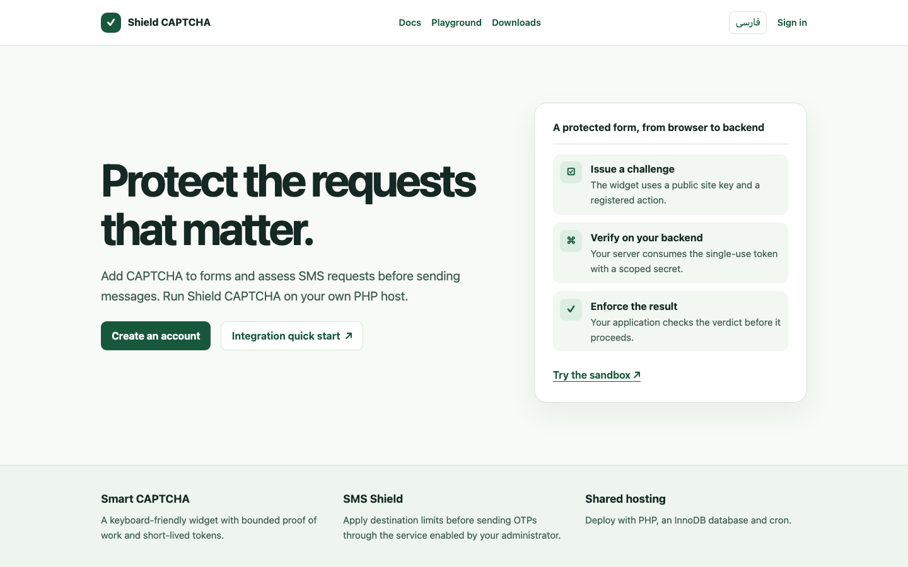
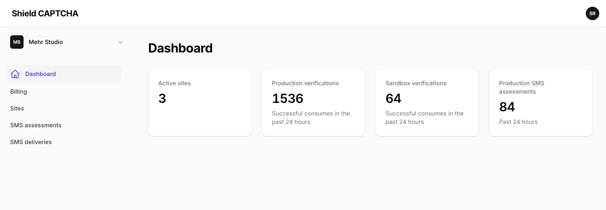
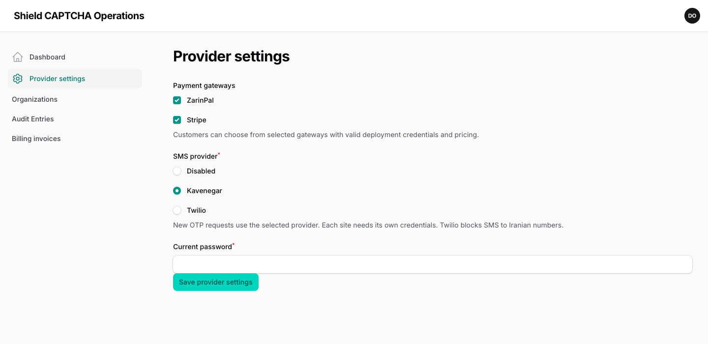
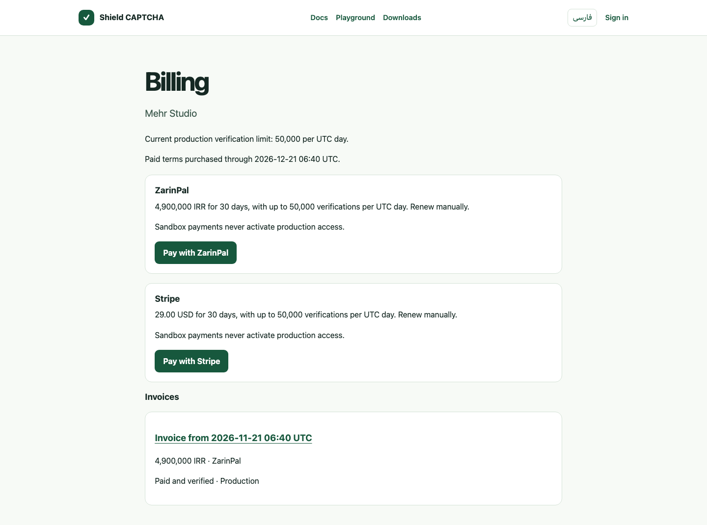
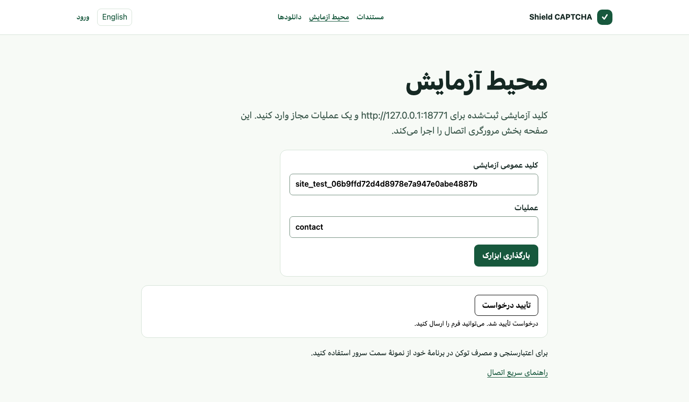

# Shield CAPTCHA — Privacy-First, Self-Hosted CAPTCHA & Bot Protection

**Self-hosted CAPTCHA, risk assessment, and SMS abuse controls for web applications.**

Shield CAPTCHA gives each organization a place to register websites, issue scoped keys, and review usage. The embeddable widget solves the challenge, and the customer’s backend verifies and consumes the resulting one-time token before accepting a protected request. Operators manage SMS routing and hosted payment gateways from a separate admin panel.

**Release 0.4.0** · Laravel 13 · Filament 5 · PHP 8.3+ · MySQL or MariaDB with InnoDB

[Download the shared-host ZIP](downloads/self-hosted/shield-captcha-shared-host-0.4.0.zip) · [Run locally](#run-locally) · [API reference](openapi/v1.yaml) · [Deployment guide](DEPLOYMENT.md)

[](docs/screenshots/overview.webp)

## Product tour

The screenshots show the running application with synthetic demo data and example prices. Select an image to view it at full size.

| Customer dashboard | Operator settings |
| --- | --- |
| <a href="docs/screenshots/customer-dashboard.webp"></a> | <a href="docs/screenshots/provider-settings.webp"></a> |
| Review active sites and recent activity by environment. | Configure payments and SMS routing across the deployment. |

| Hosted checkout | Persian CAPTCHA playground |
| --- | --- |
| <a href="docs/screenshots/checkout.webp"></a> | <a href="docs/screenshots/captcha-demo.webp"></a> |
| Choose a configured gateway for a fixed verification term. | Complete a sandbox challenge using the embeddable widget. |

## Capabilities

| Area | What the application provides |
| --- | --- |
| CAPTCHA | Bounded browser proof of work with manual, automatic on-submit, and adaptive modes. All modes use short-lived, one-time tokens with origin and action checks. The public site and widget are available in English and Persian. |
| Risk policies | Versioned limits for account, API, fraud, and automation events, with observe and enforce modes and scoped feedback. |
| Organization controls | Separate sandbox and production credentials, scoped keys, DNS TXT ownership verification, team invitations, role changes, ownership transfer, and an owner-only audit export. |
| Billing | Operator-managed plans, tenant invoice CSV export, and hosted checkout through Stripe and ZarinPal. Operators can enable either or both gateways, and customers choose at checkout. Verified production payments grant a fixed verification term with manual renewals. |
| SMS Shield | Assess destination velocity using hashed input or submit a rate-checked OTP to the selected provider. Operators select Kavenegar, Twilio, or Disabled for the whole deployment. Each sending site uses its own provider credentials. |
| Operator controls | A dedicated MFA-protected panel with provider settings, invoice lookup, scheduler status, and an audit trail for settings changes. Deselecting a payment gateway stops new checkouts while preserving verification of existing invoices. |
| Integrations | JavaScript widget, PHP and Node.js verification SDKs, WordPress and classic WooCommerce hooks, OpenAPI and Postman collections, and a runnable PHP consumer. |

Configure credentials before enabling providers at `/admin/provider-settings`. The provider guide covers supported destinations, webhook configuration, and event replay behavior. [Provider setup](docs/providers.md)

## How verification works

1. A registered site requests a challenge using its public site key and action. Shield checks the request against the site's configured origin.
2. The browser widget solves the challenge and places the issued token in `shield-captcha-response`.
3. The customer’s backend sends the token to `POST /api/v1/verify` with its scoped verification secret and expected site, action, origin, and environment.
4. Shield consumes the token and meters a successful verification in one database transaction. The customer’s backend accepts the protected request only after it receives a matching allow result.

Keep verification and SMS sending secrets on the backend. Request a fresh challenge if a verification attempt times out and its outcome is uncertain. [Security model](SECURITY_MODEL.md)

## Run locally

For a fresh install, use PHP 8.3 or later, Composer, and a fresh MySQL or MariaDB database with InnoDB. Enable `intl` and `pdo_mysql` alongside the extensions required by Composer, and `curl` for the PHP consumer. Use an SMTP mail catcher to receive local account verification messages. The default array mailer is suitable for automated tests. Node.js and npm are used to build release artifacts.

For an existing installation, preserve the application key and follow the upgrade procedure. [Deployment and upgrades](DEPLOYMENT.md#operations-and-restore)

1. Copy the sample configuration to a new `.env`.

   ```sh
   test -f .env || cp .env.example .env
   ```

2. Set `APP_URL=http://127.0.0.1:8000` and fill in `DB_HOST`, `DB_DATABASE`, `DB_USERNAME`, and `DB_PASSWORD` for the local database. To register a customer locally, set `MAIL_MAILER=smtp` and configure the host and port of your mail catcher.
3. Install dependencies, initialize the application, and start the local server.

   ```sh
   composer install --no-plugins --no-scripts
   php artisan package:discover
   php artisan key:generate
   php artisan migrate
   php artisan filament:assets
   php artisan shield:preflight
   php artisan serve --host=127.0.0.1 --port=8000 --no-reload
   ```

4. Register a customer at `/customer/register`, follow the email verification link from the mail catcher, and create an organization. To open the operator panel, run `php artisan shield:operator operator@example.test` in a separate terminal. Sign in at `/admin/login` and enroll an authenticator.

| Local path | Use it to |
| --- | --- |
| `/customer/register` | Register a customer and start organization onboarding. |
| `/admin/provider-settings` | Choose active payment gateways and the SMS provider as an operator. |
| `/admin/billing-plans` | Publish or retire plans and set their gateway prices. |
| `/customer/{organization}/team` | Invite members, assign roles, and manage ownership and exports. |
| `/playground` | Try the widget with a sandbox site registered to the Shield application's own origin. |
| `/docs`, `/api-reference` | Read integration instructions and the API contract. |
| `/downloads` | Find release artifacts and their SHA-256 checksums. |
| `/health/live`, `/health/ready` | Check application liveness and database and schema readiness. |

### Verify a form across two origins

In the customer panel, create a sandbox site for `http://127.0.0.1:8001` with action `contact`. Issue its verification key and set the public site key and verification secret as `SHIELD_SITE_KEY` and `SHIELD_VERIFY_SECRET` in the consumer process environment.

With the Shield server still running on port 8000, start the example in a separate terminal.

```sh
export SHIELD_API_ORIGIN=http://127.0.0.1:8000
export SHIELD_CONSUMER_ORIGIN=http://127.0.0.1:8001
php -S 127.0.0.1:8001 -t examples/php-consumer
```

Open `http://127.0.0.1:8001`, complete the widget, and submit the form. The consumer displays **Accepted sandbox submission** after server-side verification succeeds. It rejects a missing, invalid, or already consumed token. [PHP consumer source](examples/php-consumer/index.php) · [PHP SDK](packages/sdk/php)

## Test and deploy

Run the feature suite with SQLite using `composer test`. For the InnoDB concurrency tests, use a separate local database named `shield_test` or prefixed with `shield_test_`, set the test database credentials, and enable `pcntl`.

```sh
DB_CONNECTION=mysql DB_HOST=127.0.0.1 DB_DATABASE=shield_test \
  DB_USERNAME=shield_test php vendor/bin/phpunit --no-progress
```

See the implementation status for the current MariaDB tests, browser and package checks, upgrade evidence, and open release requirements. [Verification evidence](IMPLEMENTATION_STATUS.md#040) · [Browser and package checks](downloads/README.md)

Use the shared-host ZIP for cPanel or DirectAdmin. Serve the `public/` directory over HTTPS, keep `.env` and storage outside the web root, and configure the scheduler through cron. Follow the deployment guide for preflight, provider activation, backups, and restores. [Shared-host deployment](DEPLOYMENT.md) · [Release manifest](downloads/manifest.json)

To assemble and verify the release artifacts from source, run the following commands.

```sh
node scripts/build-releases.mjs
sh scripts/build-shared-host.sh
node scripts/build-releases.mjs
node scripts/build-releases.mjs --check
```

## Project documentation

| Reference | Contents |
| --- | --- |
| [OpenAPI](openapi/v1.yaml) and [Postman collection](openapi/shield-captcha-v1.postman_collection.json) | Challenge, verification, policy assessments, feedback, and SMS contracts. |
| [Protection guide](docs/protection.md) and [Node.js SDK](packages/sdk/node) | Policy publication, decision handling, automation credentials, feedback, and server-side token verification. |
| [Provider setup](docs/providers.md) | Stripe and ZarinPal checkout, Twilio and Kavenegar provisioning, and reconciliation. |
| [Security model](SECURITY_MODEL.md) and [privacy inventory](PRIVACY_DATA_INVENTORY.md) | Trust boundaries, data retention, and operational risk. |
| [Incident runbook](INCIDENT_RUNBOOK.md) and [vulnerability reporting](SECURITY.md) | Operational response and security contact guidance. |
| [Changelog](CHANGELOG.md) and [implementation status](IMPLEMENTATION_STATUS.md) | Release changes, verified coverage, and remaining work. |

Commercial rollout requires host-specific checks, capacity testing, and an independent protocol and accessibility review. [Remaining features and release gates](IMPLEMENTATION_STATUS.md#remaining-production-gates)

## License

Shield CAPTCHA is licensed under the GNU General Public License v2.0 only. [License text](LICENSE) · [Third-party notices](THIRD_PARTY_NOTICES.md)
